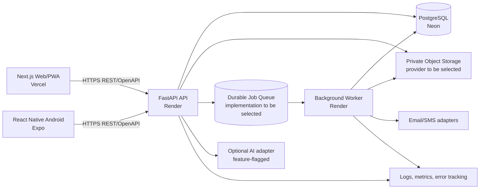

# Technical Requirements Document — Awgu StepForward

**Version:** 0.1  
**Status:** Draft technical baseline  
**Selected deployment:** Vercel (web), Render (FastAPI), Neon (PostgreSQL)

## 1. Purpose and guiding constraints

This TRD describes how the product in [`SRS.md`](SRS.md) should be implemented and operated. It is a modular monolith designed for an early pilot, with clean seams for scaling. Do not introduce microservices, Kubernetes, complex event streaming, or sharding unless measured need and an accepted ADR justify them.

Product safety and privacy constraints in [`../spec.md`](../spec.md) take priority over convenience. The backend remains the authorization and business-rule authority.

## 2. High-level architecture



All clients use one versioned API contract. Web server-side rendering may call the API server-to-server for public data, but browser and mobile clients must use the same business API and authorization rules. Do not expose Neon credentials, object-store secrets, or vendor keys to clients.

## 3. Technology baseline

| Area | Baseline |
|---|---|
| Web/PWA | Next.js App Router, TypeScript strict, Tailwind CSS, shadcn/ui, TanStack Query |
| Android | React Native, Expo, Expo Router, TypeScript, TanStack Query |
| Python API | FastAPI, Pydantic, SQLAlchemy async or repository-standard equivalent, Alembic migrations |
| Python tooling | uv and committed lockfile |
| JavaScript tooling | Bun and committed `bun.lock` |
| Data | PostgreSQL on Neon; use a bounded pool and Neon-supported pooled connectivity appropriate to the runtime |
| Hosting | Vercel frontend; Render API and worker; Neon PostgreSQL |
| API style | REST under `/api/v1`, OpenAPI as source of truth |
| Files | Private S3-compatible object storage with temporary authorized links; provider to be selected |
| Queue/cache | Redis-compatible managed service may support bounded jobs/rate limits if selected; not required for every local setup |

Select current stable compatible versions at scaffold time; commit lockfiles. Keep frontend and backend deployments independently buildable.

## 4. Backend architecture

Use a feature-based modular monolith. Suggested shape (adapt to repository conventions):

```text
backend/app/
  main.py
  core/                 # config, errors, security, logging, observability
  db/                   # engine, session, base, migrations integration
  features/
    auth/
    identity/           # applicant profile, guardian links, consent
    providers/          # provider requests, memberships, verification
    opportunities/      # listings, search, review, expiry, work terms
    applications/       # forms, drafts, submissions, status, outcomes
    sessions/           # application-support sessions and registrations
    notifications/      # preferences, templates, delivery records
    moderation/         # reports, queues, decisions
    files/              # uploads, scanning state, authorized access
    ai/                 # opt-in adapters and validation
    analytics/           # privacy-aware aggregates
  integrations/         # email, SMS, object storage, AI, queue adapters
  jobs/                 # retry-safe background tasks
  tests/
```

Feature modules own their schemas, models/repositories, service/use-case logic, routes, and tests. Shared infrastructure must not contain product-specific policy. Keep route handlers thin; enforce authorization and transitions in service/use-case code. Use dependency injection for database sessions, current actor, and external adapters.

### Backend rules

- Enforce role, tenant, age, guardian consent, listing status, deadline, and file authorization on the server for every request.
- Use database constraints and transactions for invariants; do not rely only on Pydantic/client validation.
- Make application submission idempotent with a persisted idempotency key or equivalent unique constraint and transaction.
- Store status/consent/review changes as append-only history or versioned records where required for audit.
- Use UTC-aware timestamps in storage. Render WAT in clients.
- Paginate and bound all list/search inputs. Avoid unbounded result sets and expensive wildcard queries.
- Redact PII/secrets from logs. Correlate requests and background jobs with non-sensitive IDs.
- Use explicit timeouts and bounded retries with jitter for external services. Do not retry non-idempotent writes without an idempotency strategy.

## 5. Web and Android integration

- Web route/layout composition belongs in Next.js App Router; business UI and API hooks belong in feature modules as specified in [`../frontend-spec.md`](../frontend-spec.md).
- TanStack Query owns remote state; query keys include relevant filters and user/tenant identity without leaking sensitive data in logs.
- Generate or derive TypeScript types/client from FastAPI OpenAPI. Run contract drift checks in CI.
- Public listings may be cached with explicit freshness/version behavior. Never put applicant files, guardian data, private applications, or staff records in shared caches.
- Offline drafts are local user data, protected using platform-appropriate storage. Server acknowledgment is required for final submission/moderation/verification.
- Web and mobile clients handle 401/403/404/409/422/429/5xx and offline failures distinctly. Do not treat hidden navigation as access control.
- Dark mode uses shared semantic tokens with web and native adapters; device-local System/Light/Dark preference is supported.

## 6. API and identity security

- Prefix production routes with `/api/v1`; expose health/readiness separately without secret or PII disclosure.
- Publish generated OpenAPI for contract clients. Disable or protect interactive API docs in production according to deployment/security policy.
- Use TLS end-to-end. Configure CORS for exact Vercel production and approved preview/staging origins; do not use wildcard origins with credentials.
- Authentication method and token/session lifecycle require an ADR before implementation. Baseline recommendation: secure, HttpOnly, SameSite cookies for web with CSRF defenses; secure platform storage for mobile credentials; short-lived verification codes with attempt, expiry, and resend limits. Never store session credentials in plain web localStorage.
- Protect auth, search, reporting, AI, and upload-initiation endpoints with suitable rate limits and abuse monitoring.
- Provider data queries must be tenant-scoped in backend services. Security tests should attempt cross-provider ID substitution.
- Use server-generated, short-lived upload/download permissions. Require file type/size limits, checksum, malware scan state, private objects, access audit, and retention/deletion jobs.

## 7. Data and storage

- Use Neon PostgreSQL as the system of record. The canonical conceptual model is [`ERD.md`](ERD.md).
- Use Alembic or the established migration system; every schema change is versioned and tested on an empty database and a representative upgrade path.
- Use UUID primary keys or another consistent non-sequential public identifier strategy. Internal sequential IDs must not be exposed as authorization secrets.
- Use foreign keys, unique constraints, check constraints, and indexes to encode integrity and common lookup paths.
- Do not store multi-valued relationships as comma-separated strings. Use join tables. Use JSONB only for intentionally versioned, flexible form schemas/answers or provider payloads that are not core relational dimensions.
- Define retention/deletion behavior for each personal/file record. Backups must have retention and access controls compatible with the privacy policy.
- Use a Neon pooling option suitable for server deployment; configure per-process pool size/overflow so the combined maximum across all Render API and worker instances stays within the project’s DB connection budget, leaving operational reserve. Verify transaction/session behavior against the selected pooler.

## 8. Deployment and environments

### Vercel — web/PWA

- Connect the web workspace/root and build command explicitly; configure production, preview, and development environment variables separately.
- Only public configuration uses `NEXT_PUBLIC_*`. Secrets and privileged API keys remain server-side.
- Add the production Vercel origin and approved preview origins to FastAPI CORS configuration, using an explicit allowlist.
- Validate Next.js SSR and caching rules so authenticated/personalized pages cannot be statically/shared cached.
- Use preview deployments for review, with test backend credentials and non-production data.

### Render — FastAPI and worker

- Deploy API as a container or Render-native Python service using the uv lockfile and a production ASGI command. Pin an explicit start command in project config.
- Deploy background processing as a separate worker process/service where queue implementation requires it; do not start multiple unmanaged schedulers per API replica.
- Configure health and readiness checks, request timeout policy, graceful shutdown, logs, secrets, allowed origins, and database URLs per environment.
- Keep API stateless so Render can add replicas. Store uploads in object storage, not ephemeral service disk.
- Review Render plan sleep/scale behavior, instance limits, regions, and outbound networking before choosing production settings.

### Neon — PostgreSQL

- Create separate development/test/staging/production databases or branches and credentials; prohibit production data in developer/test environments.
- Keep connection strings as managed secrets. Use pooled connection URLs where appropriate; verify migrations and long-running transactions against the selected Neon connectivity mode.
- Enable and test backups/restore per chosen Neon plan. Document recovery point/time objectives before pilot.
- Select the closest supported region to the Render service, then benchmark actual latency; do not assume co-location without checking available regions and networking options.

### Release flow

1. Pull request: formatting/lint, type checks, unit/integration tests, frontend build, backend checks, migration validation, and API contract generation/drift check.
2. Merge: deploy preview/staging; apply migrations using a controlled release step; run smoke and critical journey checks.
3. Production: human-approved release initially; observe logs/metrics, error rates, DB pool, queue depth, and rollback readiness.

## 9. Scaling, performance, and reliability

- Begin with measured vertical scaling for API/database resources. Horizontally scale stateless Render API replicas behind the managed routing/load-balancing layer when measured capacity requires it.
- Test realistic user flows and endpoint throughput independently. Ramp 100, 250, 500, and 1,000 virtual users, then continue an RPS breakpoint ramp in isolated staging. These are test stages, not a claim of 1,000-user capacity.
- Initial candidate thresholds: API read p95 <700 ms, critical writes p95 <1 s, and <1% request failures at target load. Record p50/p95/p99, RPS, test duration, infrastructure, workflow mix, CPU/memory, DB query/pool waits, active connections, and queue depth.
- Run smoke, expected-load, spike, stress/breakpoint, and soak profiles. Do not run unbounded tests or stress production.
- Keep database connection pools bounded globally across replicas. Scale/tune indexes and queries before adding replicas/read replicas. Add cache/read replicas only when evidence indicates benefit; defer sharding.
- Background work (notifications, expiry, file scan, optional AI) uses a durable queue with bounded concurrency, retry policy, dead-letter/error visibility, and queue-age alerting.
- Define timeout, rate-limit, retry/backoff, and graceful-degradation rules. AI and messaging failure must not prevent basic public browsing or application drafts.

## 10. Observability and operations

Minimum telemetry:

- Structured logs with request/job correlation IDs and PII redaction.
- Request rate, latency percentiles, error rate, status codes, and saturation per endpoint/service.
- DB active/idle connections, pool wait, slow query timing, connection errors, CPU/storage indicators available from provider.
- Queue depth/oldest age, task retries/failures, and notification delivery status.
- Upload scan state and external dependency latency/error rate, without logging document contents.
- Frontend error reporting and Web Vitals without sensitive form values.

Prepare runbooks for deployment/rollback, migration failure, DB restore, compromised provider, urgent safeguarding report, file exposure, vendor outage, and elevated API/database errors. Assign an owner and alert route before pilot.

## 11. Technical validation checklist

- [ ] Vercel, Render, and Neon staging/production environments are separate and secret-managed.
- [ ] Web/mobile API contract is generated from FastAPI OpenAPI and drift is checked.
- [ ] CORS, session/token handling, authorization, tenant scoping, file access, and rate limits have automated coverage.
- [ ] Migration and restore procedures are exercised.
- [ ] Load tests and scaling results state their infrastructure and workload assumptions.
- [ ] All external integrations are replaceable adapters and fail safely.
- [ ] No Kubernetes, microservices, sharding, or vendor-specific AI dependency is added without an ADR and evidence.

